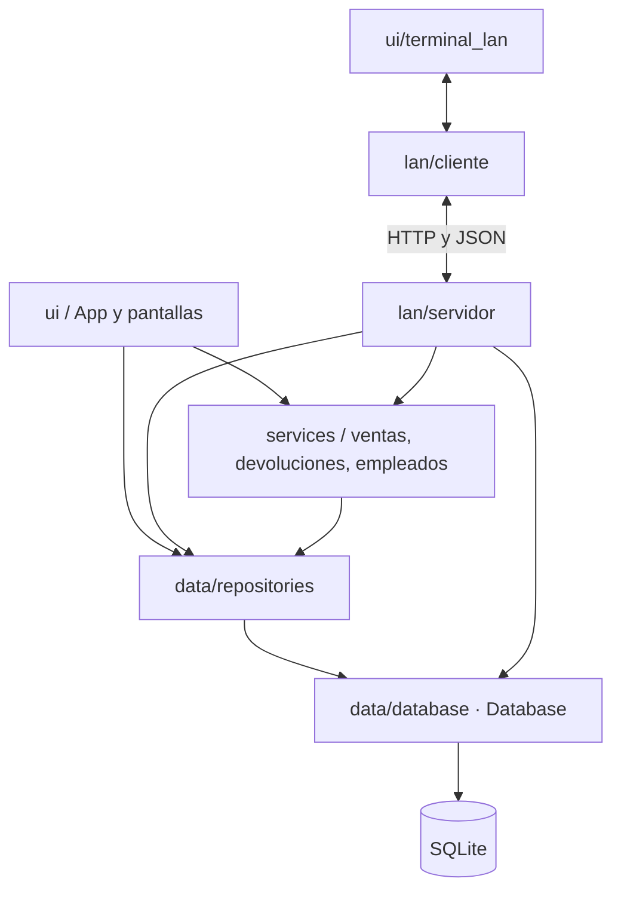
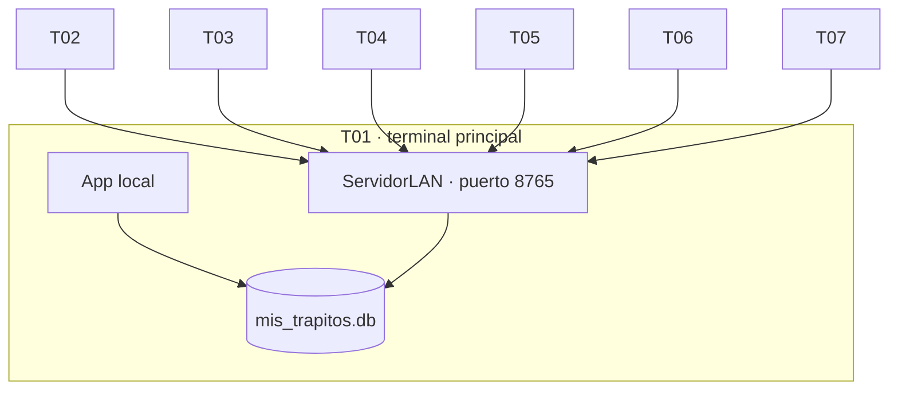

# Documento de Arquitectura de Software (SAD)

Mis Trapitos 8.0 · Equipo 3 · Arquitectura implementada

| Control documental | Valor |
| --- | --- |
| Versión y fecha | 2.0 · 24 de noviembre de 2026 |
| Línea base | `main`, commit `276fcb5`, aplicación 8.0 |
| Alcance | Terminal principal de administración y venta, servicio HTTP y terminales remotas de venta |
| Revisión | Equipo 3, pendiente de revisión documental. Antecedente: SAD 1.0 del 10/09/2026. |
| Diseño y verificación | [SDD 2.0](SDD.md) e [índice documental](README.md) |

### Índice

1. [Alcance, requisitos y supuestos](#1-alcance-requisitos-y-supuestos)
2. [Arquitectura existente y brechas](#2-arquitectura-existente-y-brechas)
3. [Decisiones tecnológicas](#3-decisiones-tecnológicas)
4. [Capas, componentes y patrones](#4-capas-componentes-y-patrones)
5. [Datos y reglas de integridad](#5-datos-y-reglas-de-integridad)
6. [Distribución física de las siete terminales](#6-distribución-física-de-las-siete-terminales)
7. [Ejecución, concurrencia y confirmación de ventas](#7-ejecución-concurrencia-y-confirmación-de-ventas)
8. [Operación sin internet, instalación y recuperación](#8-operación-sin-internet-instalación-y-recuperación)
9. [Seguridad y observabilidad](#9-seguridad-y-observabilidad)
10. [Verificación y trazabilidad de aceptación](#10-verificación-y-trazabilidad-de-aceptación)
11. [Evolución y riesgos pendientes](#11-evolución-y-riesgos-pendientes)
12. [Fuentes y método de elaboración](#12-fuentes-y-método-de-elaboración)

## 1. Alcance, requisitos y supuestos

En la tienda necesitamos vender desde distintos puestos sin asignar dos veces la última prenda de una talla. Elegimos una sola base de inventario en la terminal principal. Se puede trabajar sin acceso a internet si la red local y la principal siguen disponibles. Para el despliegue de referencia contamos siete puestos en total.

RF-01 a RF-14 abarcan catálogo, inventario, venta, promoción y contactos. RF-15 a RF-26 corresponden a doce consultas del negocio. RNF-01 exige que el inventario refleje la venta. Distinguimos el instante en que se confirma el cambio en SQLite del momento en que otra pantalla lo muestra.

## 2. Arquitectura existente y brechas

La v7 agrupaba la aplicación en un archivo. Separamos la presentación, las reglas y el acceso a datos en `mis_trapitos/`. Los PR #31, #49 y #50 permiten seguir la extracción. Algunos formularios consultan directamente un repositorio. Las operaciones que requieren autorización o varias escrituras pasan por servicios.

El alcance remoto implementado comprende sesión, inventario y ventas. El equipo principal conserva las demás pantallas, comparte archivo de datos con el servicio y controla su ciclo de vida. En esta línea base carecemos de respaldo programado, transporte TLS y persistencia de una solicitud pendiente en el puesto remoto.

## 3. Decisiones tecnológicas

### ADR-01 · Python como lenguaje de aplicación

Necesitábamos ejecutar las mismas reglas en la principal, las terminales remotas y CI. Elegimos Python 3.12 y reutilizamos `sqlite3`, `tkinter` y la biblioteca HTTP. Una aplicación nativa compilada habría requerido otro entorno para mantener los formularios y las pruebas. Con Python necesitamos distribuir el intérprete, Tcl/Tk y Pillow. El arranque está en `main.py` y las dependencias directas están fijadas en los manifiestos. Evidencia: PR #31 y #96, STS_LOG_03 (Pass).

### ADR-02 · Tkinter para la presentación

La captura por código, la selección de variantes y el ticket deben funcionar en el mostrador sin navegador. Elegimos Tkinter/ttk frente a una interfaz web. Compartimos controles y estilos en `ui/base.py` y `ui/styles.py`. La resolución y la escala afectan qué botones alcanzan a verse, por eso probamos las pantallas redimensionadas. Evidencia: `ui/app.py`, PR #32, #79 y #101, STS_UI_01 y STS_UI_02 (Pass en CI).

### ADR-03 · SQLite en el disco local de la principal

Abrir un archivo compartido desde cada caja trasladaría la coordinación de escrituras a la red. Elegimos SQLite en el disco de la principal y acceso HTTP desde las remotas. Otra opción era mantener un motor cliente-servidor que exigiría instalación y administración propias. Con nuestra decisión, la disponibilidad depende de la principal y su disco. `Database` activa las FK y usa espera de bloqueo de cinco segundos. El trabajador LAN abre su conexión con WAL. Evidencia: `data/database.py`, PR #50 y #94, CTS_BD_01, CTS_BD_02 e ITS_LAN_01 (Pass).

### ADR-04 · Capas y servicio LAN único

Una regla duplicada en las dos interfaces podía aplicar descuentos distintos. Conservamos módulos importables dentro de una sola aplicación, frente a mantener dos implementaciones o desplegar servicios separados por entidad. La interfaz local y el trabajador HTTP invocan `services/ventas.py`. Los cambios en la interfaz se prueban también con widgets reales. Evidencia: `ui/ventas.py`, `lan/servidor.py`, PR #49, #50 y #94, CTS_SDD_01 e ITS_LAN_01 (Pass).

### ADR-05 · Una autoridad de inventario

Vender sin conexión y conciliar después permitiría a dos cajas comprometer la misma prenda. Centralizamos la confirmación en la principal. Ante una comunicación incierta conservamos la clave en el carrito remoto mientras el proceso sigue abierto. El trabajador LAN procesa una solicitud a la vez y el UPDATE de stock comprueba que alcance. Evidencia: `data/repositories/productos.py`, `ui/terminal_lan.py`, PR #94, UTS_LAN_01, UTS_LAN_02 y STS_LAN_01 (Pass).

### ADR-06 · Centavos enteros

El precio de diez centavos tenía que sumar exactamente treinta al vender tres piezas. Elegimos INTEGER para los importes frente a REAL o decimales serializados como texto. `a_centavos` convierte la captura en pesos mediante Decimal y ROUND_HALF_UP. En el servicio redondeamos la partida y luego el descuento general. `dinero_centavos` devuelve la representación en pesos para mostrarla. Los porcentajes conservan su propia unidad. Esto obligó a migrar datos y a revisar consultas, ticket y respuesta LAN. Evidencia: `utils.py`, `services/ventas.py`, PR #97 (historia #88), UTS_VEN_CENTAVOS, UTS_VEN_PRECIO_CENTAVOS e ITS_MIG_02 (Pass).

### ADR-07 · Migraciones con user_version

Al abrir una base anterior debíamos distinguir un precio en pesos de otro ya convertido. Aplicar la multiplicación en cada arranque habría cambiado el valor cien veces por apertura. Elegimos una secuencia numerada en `data/schema.py` y `PRAGMA user_version` frente a inferir la versión solo por nombres de columnas. Rechazamos versiones futuras, comprobamos las FK y revertimos si falla la migración. Evidencia: PR #96 (historia #90) y #97, ITS_MIG_01 e ITS_MIG_02 (Pass).

### ADR-08 · Idempotencia de ventas LAN

Si se pierde la respuesta después de confirmar una venta, un reintento podría crear otra salida. Guardamos en `lan_requests` la clave de solicitud, huella y referencia a la venta dentro de su transacción. Frente a deducir duplicados por hora o por importe, la clave distingue dos compras iguales. Repetir clave y contenido recupera la venta original. Cambiar el contenido genera conflicto. El servidor reconstruye el stock actual al responder. Evidencia: `lan/servidor.py`, `lan/cliente.py`, PR #94, ITS_LAN_02 y UTS_LAN_02 (Pass).

### ADR-09 · PBKDF2 con sal por contraseña

El SHA-256 directo de la v7 daba el mismo valor para dos contraseñas iguales. Elegimos PBKDF2-HMAC-SHA256 en vez de conservar el digest simple. Usamos una sal aleatoria por registro y 600 000 iteraciones. El verificador acepta el formato anterior para actualizarlo después de un acceso válido. La verificación consume tiempo de CPU y el número de iteraciones depende de una constante del código. Evidencia: `utils.py`, `data/repositories/empleados.py`, PR #95, CTS_SEG_01 y CTS_SEG_02 (Pass).

## 4. Capas, componentes y patrones

Inyectamos la conexión en pantallas, servicios y repositorios. La transacción exterior se responsabiliza de confirmar o revertir las llamadas anidadas. En la terminal remota, `CarritoLAN` separa el borrador de venta de los widgets. En la principal, `ServicioVentas` cumple esa función para la UI local.

## 5. Datos y reglas de integridad

El catálogo identifica cada variante por un código único. Una venta activa guarda empleado, cliente opcional, pago e importes. Cada partida conserva precio, cantidad y porcentaje aplicado. Ligamos las salidas y reposiciones a su venta mediante `inventory_movements.related_sale_id`. El diccionario y las cardinalidades están en [SDD, sección 5](SDD.md#5-diseño-de-datos).

Cuando una venta tiene partidas repetidas, la cancelación suma las cantidades por producto antes de descontar las devoluciones. La validación de estado de la cancelación y las lecturas previas de la devolución todavía dejan una ventana de concurrencia. La consulta de utilidades usa el costo de compra vigente y no dispone de costo histórico en la partida.

## 6. Distribución física de las siete terminales

En T01 ejecutamos `python main.py --servidor`. Por defecto escucha en `0.0.0.0:8765` y admite `--host` y `--puerto`. En T02 a T07 ejecutamos `python main.py --terminal http://IP:8765` con la dirección de T01. Cada terminal remota carga `TerminalLAN`. Para trabajar en una sola computadora basta `python main.py`. Cerrar la ventana de la principal termina también el servicio. El esquema de siete puestos representa el despliegue previsto. La aceptación física completa sigue pendiente.

## 7. Ejecución, concurrencia y confirmación de ventas

El servidor autentica la sesión, toma de ella al empleado y normaliza las partidas por producto. Con `ThreadPoolExecutor(max_workers=1)` concentra las operaciones de red en un trabajador dueño de su conexión. La UI de T01 escribe con otra conexión al mismo archivo. SQLite coordina el acceso mediante `BEGIN IMMEDIATE`.

En una sola transacción verificamos la clave, releemos stock, precio y promoción, guardamos la cabecera y las partidas, descontamos el inventario, registramos la SALIDA y asociamos la clave. Si algo falla revertimos el conjunto. En el reintento con huella idéntica devolvemos el mismo ID de venta. Si el descuento de stock rebasa lo disponible, la operación se rechaza.

La terminal vendedora recibe el stock de los productos vendidos. En las demás, el sondeo de 2 s pide el inventario al servicio. En T01 detectamos escrituras de otras conexiones con `PRAGMA data_version`. STS_LAN_02 verificó el umbral de 5 s para RNF-01 en su entorno. El intervalo programado y la latencia observada son medidas distintas.

## 8. Operación sin internet, instalación y recuperación

El ambiente declarado por el Test Plan es Windows 10/11 o Ubuntu 22.04, Python 3.12, SQLite 3 con base temporal por prueba y `load_examples=False`, pytest 8 con pytest-cov, y Tkinter con Xvfb en GitHub Actions (`ubuntu-latest`). En la línea base, `requirements-dev.txt` fija pytest 9.2.0 y pytest-cov 7.1.0. La dependencia de ejecución en `requirements.txt` es Pillow 12.3.0.

La principal funciona localmente con datos existentes, sin internet. Una remota desconectada pierde la posibilidad de confirmar. Arrancar sobre una base vacía crea el esquema sin ejemplos y el login necesita un empleado previamente aprovisionado. La evidencia de instalación manual se obtuvo el 29 de octubre, antes de este cambio de inicialización.

Comprobamos integridad tras la caída de un proceso de venta en STS_REC_01. Queda pendiente restaurar una copia que contenga base y fotos en otro equipo, medir tiempo de recuperación y pérdida de datos, y conciliar claves de ventas posteriores a la copia.

## 9. Seguridad y observabilidad

Autenticamos por HTTP con usuario y contraseña. Las peticiones siguientes llevan un token Bearer válido hasta doce horas. El servidor comprueba la pertenencia al consultar una venta por clave. La administración de empleados en la principal está reservada a Administrador y Propietario. Faltan cifrado TLS y una política por operación para los demás módulos.

Los movimientos y las partidas permiten reconstruir el efecto de una venta. Los errores de red distinguen rechazo definitivo de estado incierto. La aplicación mantiene en memoria tanto la sesión del servidor como la clave pendiente del carrito remoto. Tras reiniciar se necesita conciliación si quedó una respuesta sin recibir.

## 10. Verificación y trazabilidad de aceptación

Cruzamos cada escenario original con el TC más cercano. El estado entre paréntesis corresponde al TC. Cuando el alcance difiere, describimos qué condición sigue sin evidencia. La corrida 75 registró 94 TC con Pass de 97 planeados.

| Escenario | Condición original | Resultado y alcance probado |
| --- | --- | --- |
| PA-01 | Instalación y operación sin internet en siete puestos. | ATS_INS_01, Pass en un equipo y una versión anterior a esta línea base. Falta repetir en los siete puestos de la 8.0. |
| PA-02 | Siete solicitudes simultáneas por una unidad. | STS_LAN_01, Pass con dos remotas y la principal por una pieza y ocho clientes por cinco piezas. ATS_VD_09, Not executed. Falta la configuración exacta de siete. |
| PA-03 | Fallo entre detalle y movimiento con reversión total. | ITS_VEN_02 y STS_REC_01, Pass. Fallo al insertar la partida y caída después de cabecera. No se inyectó el fallo después de insertar el detalle y antes del movimiento. |
| PA-04 | Respuesta perdida y reinicio antes del reenvío. | ITS_LAN_02 y UTS_LAN_02, Pass para reenvío de la misma clave. El reinicio del cliente pierde la clave en memoria. |
| PA-05 | Dos reposiciones simultáneas sobre la misma venta. | ITS_VEN_07 e ITS_VEN_08, Pass en secuencia. Falta simultaneidad y comprobación dentro del bloqueo. |
| PA-06 | Corte y recuperación de LAN conservando borrador. | UTS_LAN_02 e ITS_LAN_03, Pass para reintento y falta de servicio. Falta el recorrido físico completo con desconexión y reconexión. |
| PA-07 | Cerrar la UI de la principal con servicio independiente. | STS_LOG_03, Pass para el arranque local. En main.py cerrar la UI detiene el servidor. El TC no comprueba continuidad de las seis remotas. |
| PA-08 | Reflejo de stock en el puesto vendedor y otros en 5 s. | ITS_LAN_01 y STS_LAN_02, Pass. ATS_VD_08, Not executed en dispositivos físicos. |
| PA-09 | Restauración completa, imágenes y conciliación de claves. | STS_REC_01 y CTS_BD_02, Pass para caída de proceso e integridad. Falta ensayo de restauración y detección de claves posteriores al respaldo. |
| PA-10 | Rechazo de operaciones administrativas por la API. | ITS_SEG_01 y STS_SEG_01, Pass para administración local de empleados. ITS_LAN_03, Pass para sesión. La API carece de operación administrativa equivalente. ATS_SEG_01, Not executed. |
| PA-11 | Siete sesiones, 30 min, 10 000 variantes, 100 000 ventas y 300 000 partidas. | STS_CAR_01, Pass con 1 500 ventas y 40 productos. No se midió el percentil 95 en siete puestos ni el objetivo de reportes de 10 s bajo esa carga. |
| PA-12 | Cambio de precio, promoción o stock con carrito o ficha antiguos. | UTS_VEN_05 e ITS_VEN_03, Pass para stock insuficiente y promoción vigente. Se releen datos al vender. Falta aprobación de precio cambiado y control de versión de ediciones. |

## 11. Evolución y riesgos pendientes

| Condición | Efecto y evidencia pendiente |
| --- | --- |
| HTTP sin TLS y permisos parciales (B-01, B-04) | Las credenciales y el token viajan sin cifrado. Solo se comprueba el rol para administración de empleados. Los defectos históricos #56 y #57 están cerrados. Falta aceptación manual, ATS_SEG_01, ATS_VD_08 y ATS_VD_09. |
| Pérdida de T01, respaldo y fotos (B-07, B-09) | El servicio depende del proceso de escritorio. Falta copia/restauración conjunta de base e imágenes con conciliación de claves. Los objetivos originales de RPO de una hora y RTO de 60 minutos carecen de ensayo. |
| Solicitud incierta tras reiniciar (B-01) | El servidor conserva la clave confirmada. El puesto remoto pierde su clave pendiente al salir. PA-04 y PA-09 siguen parcialmente cubiertos o sin ensayo. |
| Reposición concurrente (B-03) | Las validaciones previas al bloqueo permiten lecturas obsoletas. PR #99 corrigió las partidas duplicadas del defecto #53. Falta un ensayo simultáneo de cancelación o devolución. |
| Costo y cifras de reportes (B-05, B-06) | El defecto #54 se cerró para «Ventas por producto». Queda acordar el efecto de devoluciones y descuentos por reporte y el costo histórico. |
| Operación de siete puestos (B-09) | La carga y los tiempos de STS_CAR_01 difieren de PA-11. Falta medir el escenario completo en el equipo de la tienda y validar el primer acceso después de una instalación limpia de la 8.0. |

Bug report registra siete defectos cerrados y cero abiertos. Los pendientes de esta sección describen límites de implementación y de evidencia, sin asignarles identificadores de defecto nuevos.

## 12. Fuentes y método de elaboración

Para revisar la extracción de capas examinamos [los servicios](../mis_trapitos/services/) y [los repositorios](../mis_trapitos/data/repositories/). La política de escrituras y la relación de la clave con su venta se pueden seguir en [el servicio LAN](../mis_trapitos/lan/servidor.py). La duración de la clave pendiente y el sondeo están en [la terminal remota](../mis_trapitos/ui/terminal_lan.py). Las condiciones concretas de concurrencia y los límites temporales se reproducen en [las pruebas LAN](../tests/test_lan.py).

Contrastamos [el código de la línea base](https://github.com/SQEquipo3/Trapitos/tree/276fcb5), [las fichas y metadatos](testing/README.md) y [las pruebas](../tests/) con los libros publicados en la [corrida 75](https://github.com/SQEquipo3/Trapitos/actions/runs/45336280390). El [release qa-latest](https://github.com/SQEquipo3/Trapitos/releases/tag/qa-latest) se actualiza con cada publicación desde main.

| Archivo publicado | Uso |
| --- | --- |
| SW_Test_Plan_Team03_Trapitos.xlsx | Alcance, ambiente, criterios y Matrix. |
| TC_Design_Team03_Trapitos.xlsx | Objetivo, pasos, requisitos y resultado esperado de cada TC. |
| SWT_summary_report_Team03_Trapitos.xlsx | Summary, Detailed status y Bug report de la ejecución. |
