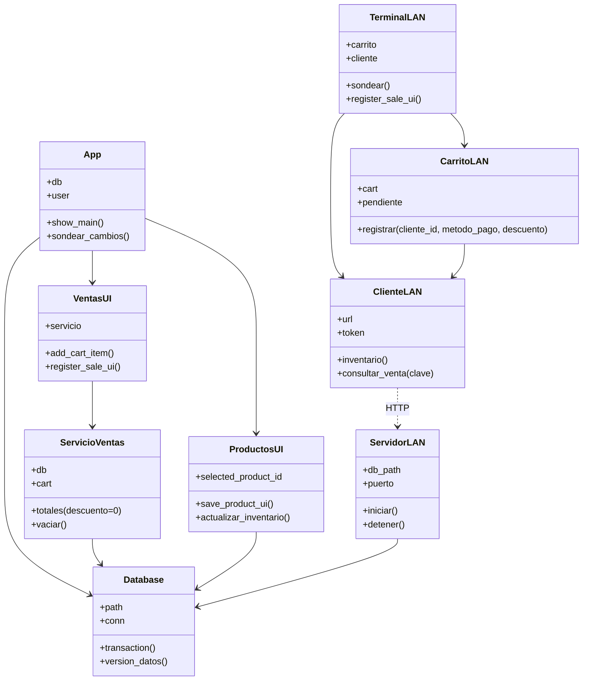
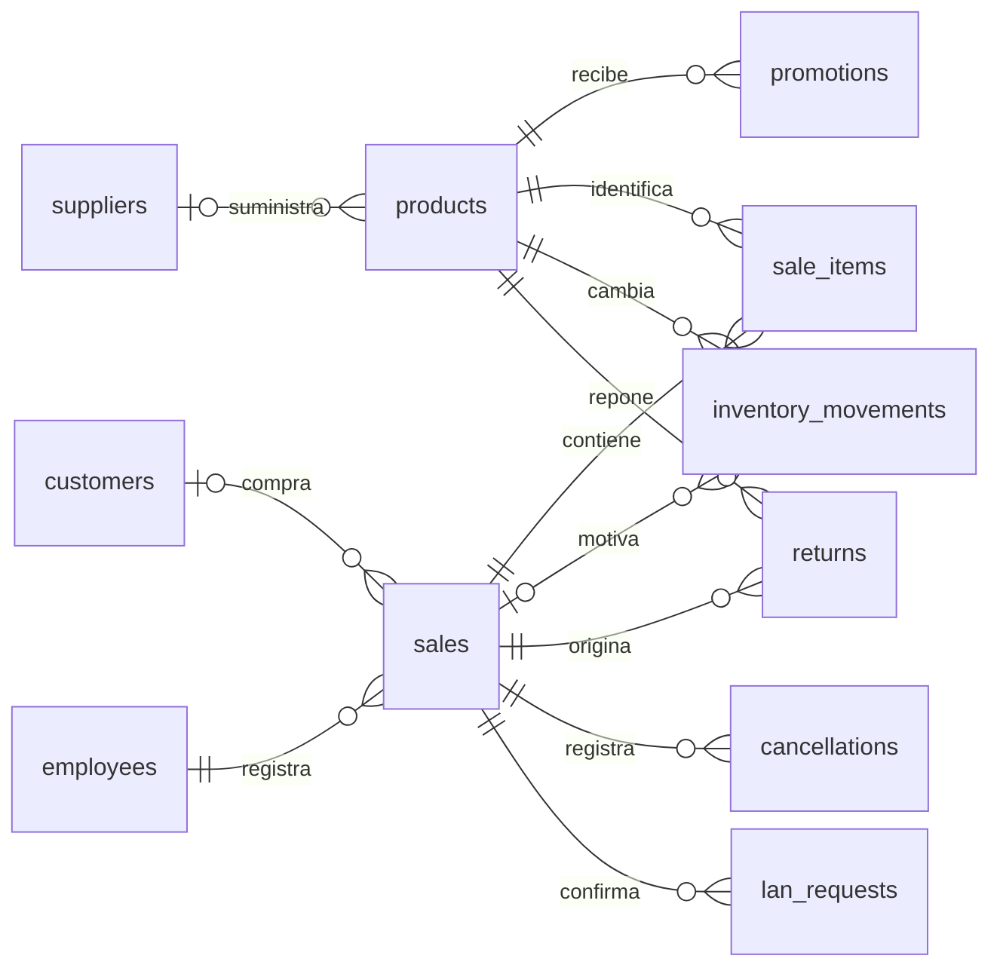
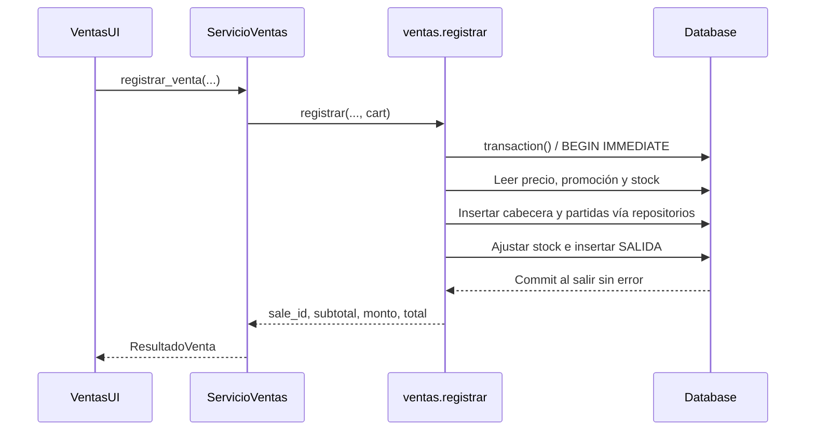
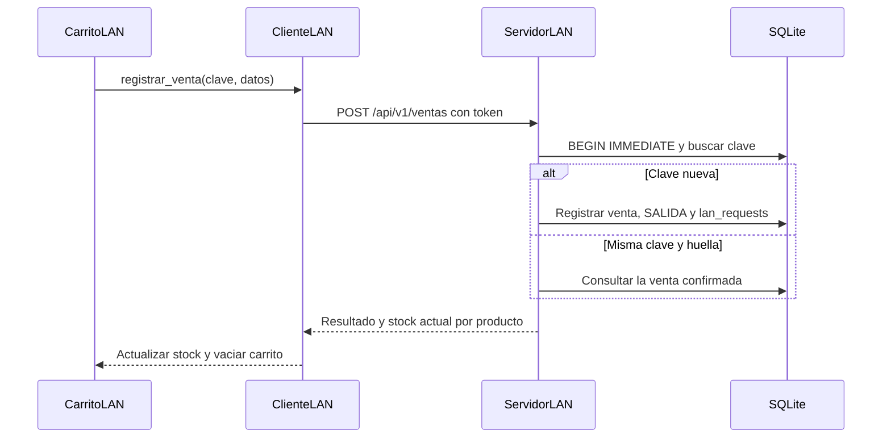

# Documento de Diseño de Software (SDD)

Mis Trapitos 8.0 · Equipo 3 · MT-SDD-001

| Control documental | Valor |
| --- | --- |
| Versión y fecha | 2.0 · 24 de noviembre de 2026 |
| Línea base | `main` en `276fcb5`, aplicación 8.0 |
| Estado | Diseño implementado. Revisión del equipo pendiente |
| Documentos relacionados | [SAD 2.0](SAD.md) e [índice de entregables](README.md) |
| Historias | [Diseño #5](https://github.com/SQEquipo3/Trapitos/issues/5) y [documentación #3](https://github.com/SQEquipo3/Trapitos/issues/3) |

### Historial de revisiones

| Versión | Fecha | Descripción |
| --- | --- | --- |
| 1.0 | 10/09/2026 | Documentamos el diseño de la v7 y propusimos el despliegue para siete terminales. |
| 2.0 | 24/11/2026 | Contrastamos las capas, los contratos y las brechas de la 8.0 con los 97 casos de la corrida 75. |

### Índice

1. [Introducción y criterios de elaboración](#1-introducción-y-criterios-de-elaboración)
2. [Contexto y arquitectura](#2-contexto-y-arquitectura)
3. [Diseño de módulos y clases](#3-diseño-de-módulos-y-clases)
4. [Diseño de interfaces Tkinter](#4-diseño-de-interfaces-tkinter)
5. [Diseño de datos](#5-diseño-de-datos)
6. [Operaciones y diagramas de secuencia](#6-operaciones-y-diagramas-de-secuencia)
7. [Diseño de comunicación y concurrencia](#7-diseño-de-comunicación-y-concurrencia)
8. [Seguridad, archivos y operación](#8-seguridad-archivos-y-operación)
9. [Trazabilidad de requisitos](#9-trazabilidad-de-requisitos)
10. [Verificación y aceptación documental](#10-verificación-y-aceptación-documental)
11. [Brechas y decisiones pendientes](#11-brechas-y-decisiones-pendientes)
12. [Referencias](#12-referencias)

## 1. Introducción y criterios de elaboración

Diseñamos Mis Trapitos para que la persona que vende una prenda pueda registrar el cobro y saber cuántas piezas quedan de esa talla y color. El mismo registro alimenta el historial del cliente, los movimientos de inventario y los reportes. Este documento describe lo que ejecuta la versión 8.0. El SAD explica por qué elegimos esa distribución.

El Test Plan incluye datos, servicios, promociones, doce requisitos de reportes, pantallas Tkinter, aceptación y conformidad. Su hoja Strategy aún enumera LAN, permisos y migraciones fuera de alcance. En las secciones 7 a 11 identificamos lo que las fichas de esa misma edición sí probaron y las verificaciones manuales pendientes.

## 2. Contexto y arquitectura

Separar la captura de la escritura nos permitió usar la misma regla de venta desde el mostrador y desde una terminal remota. En la terminal principal, `App` abre una conexión local y la comparte con las pantallas. En modo servidor hay además una conexión del trabajador HTTP a la misma base. Las terminales remotas usan JSON sobre HTTP para consultar inventario y vender.

Con `python main.py` abrimos la aplicación local. Con `python main.py --servidor` atendemos también a las terminales remotas. En cada una de ellas ejecutamos `python main.py --terminal http://IP:8765`, sustituyendo IP por la dirección de la principal. Concentramos las operaciones administrativas en la principal.

## 3. Diseño de módulos y clases

### 3.1 Componentes

| Componente | Implementación y responsabilidad |
| --- | --- |
| MOD-01 | `ui/app.py` monta las pantallas. `ui/base.py` comparte formularios, tablas y desplazamiento. `ui/styles.py` configura los estilos. |
| MOD-02 | `data/database.py` abre SQLite y controla las transacciones. `schema.py` crea y migra la base. `seed.py` carga ejemplos bajo petición. Los repositorios contienen las consultas de cada entidad. |
| MOD-03 | `ui/productos.py` captura variantes, muestra sus existencias y exporta el inventario. `data/product_images.py` conserva las fotos. |
| MOD-04 | `config.py` fija versión, formatos y medios de pago. `utils.py` concentra fecha, importes y contraseñas. `ui/rastreabilidad.py` conserva el catálogo RF/RNF. |
| MOD-05 | `tests/` contiene casos identificados con `@tc` y fichas en el docstring. Usamos bases temporales y widgets reales para ejercitar la interfaz. |
| Servicios y LAN | `services/ventas.py`, `devoluciones.py` y `empleados.py` aplican reglas compartidas. `lan/servidor.py` ejecuta las solicitudes que envía `lan/cliente.py`. |

### 3.2 Diagrama de clases

### 3.3 Contratos

En estas firmas, `db` es la conexión de trabajo. Los nombres `ventas_srv` y `devoluciones_srv` designan módulos de servicios. La capa que inicia la transacción decide cuándo confirmar todas las escrituras.

| Firma | Resultado y condiciones |
| --- | --- |
| `empleados_repo.autenticar(db, username, password)` | Devuelve la fila del empleado o `None`. Un acceso válido actualiza un hash heredado. |
| `productos_repo.guardar(db, product_id, data)` | Devuelve el ID creado o editado. Recibe los dos precios en pesos, los convierte a centavos y registra el cambio de existencias. |
| `ventas_srv.registrar(db, customer_id, employee_id, metodo_pago, descuento, cart)` | Devuelve `(sale_id, subtotal, monto, total)`. Los últimos tres enteros son centavos. `descuento` de entrada es un porcentaje. Rechaza carrito vacío, pago inválido, cantidad no positiva o stock insuficiente. |
| `ServicioVentas.registrar_venta(self, customer_id, employee_id, metodo_pago, descuento=0)` | Valida al cliente opcional, llama a `registrar`, vacía el carrito al confirmar y devuelve `ResultadoVenta` con ID, fecha, subtotal, descuento, total y método. |
| `devoluciones_srv.devolver(db, sale_id, product_id, quantity, reason)` | Rechaza una venta cancelada o una cantidad fuera del saldo. Repone piezas, registra la devolución y devuelve `None`. |
| `devoluciones_srv.cancelar_venta(db, sale_id, reason)` | Agrupa partidas por producto, repone el remanente y marca la venta cancelada. Devuelve `None`. |
| `reportes_repo.ejecutar(db, name, param="")` | Selecciona la consulta por nombre. Los resultados tabulares alimentan la vista y su CSV. |

### 3.4 Colaboración entre componentes

Para guardar un proveedor, la pantalla Contactos llama al repositorio. Para administrar empleados, esa misma pantalla pasa por el servicio que relee el rol del usuario. En una venta, el servicio necesita varios repositorios porque cambia cabecera, detalle e inventario juntos.

## 4. Diseño de interfaces Tkinter

| Vista | Clase y recorrido |
| --- | --- |
| UI-01 · Login | `Login` entrega usuario y contraseña a la función de autenticación y abre la sesión cuando recibe un empleado válido. |
| UI-02 · Productos | `ProductosUI` captura código, talla, color, precios y existencias. Permite editar la selección, adjuntar foto y exportar CSV. |
| UI-03 · Ventas | `VentasUI` agrega por código, consolida cantidades y muestra el ticket. Acepta efectivo, tarjetas de crédito y débito o transferencia bancaria. |
| UI-04 · Clientes | `ContactosUI` guarda datos de contacto, región y preferencias. Desde una selección consultamos el historial y preparamos el texto de un correo. |
| UI-05 · Proveedores | `ContactosUI` registra contacto, productos suministrados y fecha del último pedido. Un producto puede quedar sin proveedor. |
| UI-06 · Empleados | `ContactosUI` comprueba el permiso de administración. Al editar, una contraseña vacía conserva la existente. |
| UI-07 · Promociones | `PromocionesUI` valida producto, porcentaje y fechas. En la venta aplicamos el mayor porcentaje vigente. |
| UI-08 · Devoluciones | `DevolucionesUI` recibe venta, producto, cantidad y motivo. La cancelación actúa sobre la venta completa. |
| UI-09 · Reportes | `ReportesUI` ejecuta la consulta seleccionada, admite parámetros y exporta filas. El menú ofrece 24 consultas, incluidas las doce de RF-15 a RF-26. |
| UI-10 · Rastreabilidad | `RastreabilidadUI` muestra requisitos y configuración. Su prueba básica puede registrar una venta en la base abierta. |
| Terminal LAN | `TerminalLAN` reutiliza el login, muestra inventario y permite vender con `CarritoLAN`. Actualiza el stock al recibir la confirmación y vuelve a consultar por sondeo. |

## 5. Diseño de datos

### 5.1 Modelo relacional

Distinguimos la variante (`products`) de la partida vendida (`sale_items`). Conservamos en la partida el precio unitario y la promoción de la operación. Un movimiento guarda la cantidad con signo y puede referirse a una venta. Las relaciones de la figura corresponden a claves foráneas declaradas.

### 5.2 Diccionario de datos

Agrupamos las columnas de cada tabla por tipo declarado y condición. PK identifica la clave primaria y FK indica su destino. Los importes son centavos y los porcentajes conservan tipo REAL. Las fechas se guardan como TEXT.

| Tabla | Tipo y condición | Columnas |
| --- | --- | --- |
| cancellations | INTEGER · PK | id |
| cancellations | INTEGER · obligatorio | sale_id → sales.id |
| cancellations | TEXT · obligatorio | cancel_datetime |
| cancellations | TEXT · opcional | reason |
| customers | INTEGER · PK | id |
| customers | TEXT · obligatorio | name, created_at |
| customers | TEXT · opcional | phone, email, address, city_region, preferences |
| employees | INTEGER · PK | id |
| employees | TEXT · obligatorio | name, username (único), password_hash, role, created_at |
| inventory_movements | INTEGER · PK | id |
| inventory_movements | INTEGER · obligatorio | product_id → products.id, quantity |
| inventory_movements | TEXT · obligatorio | movement_type, movement_datetime, reason |
| inventory_movements | INTEGER · opcional | related_sale_id → sales.id |
| lan_requests | TEXT · PK | request_key |
| lan_requests | TEXT · obligatorio | fingerprint, created_at |
| lan_requests | INTEGER · obligatorio | sale_id → sales.id, employee_id |
| products | INTEGER · PK | id |
| products | TEXT · obligatorio | code (único), name, category, size, color, entry_date, created_at |
| products | INTEGER · obligatorio | purchase_price (≥ 0), sale_price (≥ 0), stock (≥ 0) |
| products | INTEGER · opcional | supplier_id → suppliers.id |
| products | TEXT · opcional | brand, season, image_path |
| promotions | INTEGER · PK | id |
| promotions | INTEGER · obligatorio | product_id → products.id |
| promotions | REAL · obligatorio | discount_percent (0 a 100) |
| promotions | TEXT · obligatorio | start_date, end_date, created_at |
| returns | INTEGER · PK | id |
| returns | INTEGER · obligatorio | sale_id → sales.id, product_id → products.id, quantity (> 0) |
| returns | TEXT · obligatorio | return_datetime |
| returns | TEXT · opcional | reason |
| sale_items | INTEGER · PK | id |
| sale_items | INTEGER · obligatorio | sale_id → sales.id, product_id → products.id, quantity (> 0), unit_price, line_total |
| sale_items | REAL · obligatorio | promo_discount_percent (por defecto 0) |
| sales | INTEGER · PK | id |
| sales | TEXT · obligatorio | sale_datetime, payment_method, status (por defecto 'ACTIVA') |
| sales | INTEGER · opcional | customer_id → customers.id |
| sales | INTEGER · obligatorio | employee_id → employees.id, subtotal, discount_amount, total |
| sales | REAL · obligatorio | sale_discount_percent (por defecto 0) |
| suppliers | INTEGER · PK | id |
| suppliers | TEXT · obligatorio | name (único), created_at |
| suppliers | TEXT · opcional | phone, address, products_supplied, last_order_date |

### 5.3 Migraciones

La migración 1 agrega a `suppliers` los campos de suministros y último pedido cuando faltan. La migración 2 reconstruye `products`, `sales` y `sale_items`. Multiplica por 100, redondea en SQL y convierte a INTEGER antes de sustituir las tablas. Conservamos los identificadores para que los detalles y movimientos sigan apuntando al mismo registro.

Comparamos `PRAGMA user_version` con el registro `MIGRACIONES`. Rechazamos una versión superior a la conocida. Para las pendientes, desactivamos temporalmente las FK, abrimos `BEGIN IMMEDIATE`, cambiamos la versión por paso y comprobamos `foreign_key_check` antes del commit. Un error revierte la transacción. Al salir, reactivamos las FK.

## 6. Operaciones y diagramas de secuencia

### 6.1 OP-01 · Autenticación

`Login.submit` llama a la función de acceso que recibió al construirse. En la principal consultamos `employees` por usuario, verificamos la contraseña y entregamos la fila a `App`. En la remota el servidor devuelve el token y los datos públicos del empleado.

### 6.2 OP-02 · Alta y edición de productos

`productos.guardar` convierte los precios con `a_centavos` y normaliza la foto antes de abrir la transacción. El alta inserta la variante y su ENTRADA. Al editar comparamos el stock anterior con la captura y solo registramos un AJUSTE si cambió.

### 6.3 OP-03 · Registro de venta

Redondeamos cada partida tras la promoción y después el descuento sobre el subtotal. En CTS_SDD_01, 60 000 centavos menos 6 000 dan 54 000. Si falla la inserción de una partida, la cabecera tampoco queda confirmada.

### 6.4 OP-04 · Devolución

Validamos que la venta siga activa y que la cantidad quepa en lo vendido menos lo devuelto. En una transacción insertamos la devolución, aumentamos el stock y anotamos un movimiento DEVOLUCION. La comprobación del saldo ocurre antes del bloqueo de escritura.

### 6.5 OP-05 · Cancelación

Agrupamos las partidas aunque un mismo producto aparezca dos veces. Restamos lo devuelto, reponemos lo pendiente y registramos CANCELACION. En la misma transacción cambiamos el estado e insertamos el motivo. B-03 conserva el riesgo de dos solicitudes concurrentes.

### 6.6 OP-06 · Consultas, historial y exportación

`clientes.historial` recupera las ventas del cliente seleccionado. En reportes, `reportes.ejecutar` recibe nombre y parámetro. La UI presenta importes en pesos y permite exportar la tabla. En «Ventas por producto» descontamos las piezas devueltas. En «Resumen de utilidades» todavía calculamos el costo con el precio de compra actual del catálogo.

## 7. Diseño de comunicación y concurrencia

### 7.1 Contrato HTTP

Bajo `/api/v1`, `POST /sesion` autentica y entrega el token. `GET /inventario`, `POST /ventas` y `GET /ventas/<clave>` exigen sesión Bearer. El servidor identifica al empleado desde la sesión. La consulta de una clave exige que pertenezca a ese empleado.

### 7.2 OP-07 · Venta por LAN implementada

Si cambia la huella de una clave existente, rechazamos la solicitud. Si la respuesta se pierde, el carrito conserva la clave en memoria y permite reintentar. Al cerrar el proceso se pierde esa copia. La principal mantiene la relación entre clave y venta en SQLite.

### 7.3 Refresco y exclusión de escritura

El trabajador del servicio serializa las solicitudes LAN. La UI principal escribe con otra conexión. `BEGIN IMMEDIATE` y el descuento condicionado a stock suficiente coordinan ambas rutas. Programamos el sondeo cada 2 s en las dos interfaces. La principal consulta `PRAGMA data_version` y la remota vuelve a pedir inventario. STS_LAN_02 midió visibilidad dentro de 5 s en el entorno de prueba.

## 8. Seguridad, archivos y operación

Para contraseñas nuevas usamos PBKDF2-HMAC-SHA256 con 600 000 iteraciones y sal aleatoria de 16 bytes. Guardamos algoritmo, sal y resultado. Al autenticar una cuenta antigua comprobamos el SHA-256 heredado y lo sustituimos tras un acceso válido. La administración de empleados relee el rol en la base y exige Administrador o Propietario. En LAN la sesión dura hasta doce horas y se mantiene en memoria.

Guardamos cada foto con un UUID y una referencia relativa a `mis_trapitos_imagenes`. Al abrir la base, recuperamos rutas anteriores cuando existe el archivo y conservamos la referencia si falta. Copiar una foto y guardar la variante son operaciones distintas. El respaldo tiene que incluir la carpeta de imágenes además de la base.

## 9. Trazabilidad de requisitos

Leímos los requisitos de cada ficha del TC Design y cruzamos su identificador con Detailed status del Test Report. La columna de resultado conserva los estados del Excel. Un caso puede contribuir a varias filas. Los identificadores adicionales de conformidad, seguridad y soporte se rastrean con el mismo criterio.

| Requisito | Componente, sección y ADR | Casos y estado en Detailed status |
| --- | --- | --- |
| RF-01 · Registrar productos con categoria, descripcion, precio, talla y color | ProductosUI / productos.guardar. §4, 6. ADR-04 | UTS_PRO_01, UTS_PRO_02, UTS_PRO_03, ITS_PRO_IMG_01, STS_PRO_01, STS_PRO_02, STS_PRO_03, STS_UI_01, ATS_UX_01, ATS_VD_01 (Pass) |
| RF-02 · Manejar variaciones de talla y color con existencias | ProductosUI / productos.guardar. §4, 6. ADR-03 | UTS_PRO_04, STS_PRO_01, ATS_VD_01 (Pass) |
| RF-03 · Agregar productos y actualizar cantidades de inventario | productos.guardar / registrar_movimiento. §5, 6. ADR-03 | UTS_PRO_03, ITS_INV_01, ITS_INV_02, ITS_REP_06, STS_PRO_02, STS_PRO_04, ATS_VD_02 (Pass) |
| RF-04 · Actualizar inventario automaticamente al registrar venta | ventas.registrar / productos.ajustar_stock. §6, 7. ADR-05, ADR-08 | UTS_LAN_01, UTS_LAN_02, UTS_VEN_05, ITS_INV_03, ITS_LAN_01, ITS_VEN_01, ITS_VEN_02, STS_LAN_01, STS_PRO_06, STS_REC_01, ATS_VD_03 (Pass) · ATS_VD_09 (Not executed) |
| RF-05 · Registrar movimientos de inventario | productos.registrar_movimiento / devoluciones. §5, 6. ADR-03 | ITS_INV_01, ITS_INV_02, ITS_VEN_04, ITS_VEN_05, ITS_VEN_06, ITS_VEN_07, ITS_VEN_08, STS_DEV_01, STS_DEV_02, ATS_VD_02, ATS_VD_04, CTS_BD_01, CTS_SDD_02 (Pass) |
| RF-06 · Registrar ventas con productos, cantidades y metodo de pago | ServicioVentas / ventas.registrar. §3, 6. ADR-04, ADR-06 | UTS_UTL_01, UTS_VEN_01, UTS_VEN_CENTAVOS, UTS_VEN_PRECIO_CENTAVOS, ITS_LAN_01, ITS_MIG_02, ITS_VEN_01, STS_REC_01, STS_UI_01, STS_UI_02, ATS_UX_01, ATS_VD_03, CTS_BD_03, CTS_SDD_01 (Pass) |
| RF-07 · Registrar pagos en efectivo, tarjeta y transferencia | PAYMENT_METHODS / ventas.registrar. §3, 6. ADR-04 | UTS_VEN_02, UTS_VEN_03, ATS_VD_03, CTS_SDD_03 (Pass) |
| RF-08 · Aplicar descuentos a ventas | ventas.calcular_descuento. §3, 6. ADR-06 | UTS_VEN_04, UTS_VEN_06, UTS_VEN_CENTAVOS, ITS_MIG_02, ATS_VD_03, CTS_SDD_01 (Pass) |
| RF-09 · Registrar promociones con porcentaje y duracion | PromocionesUI / promociones.guardar. §4, 6. ADR-04 | UTS_VEN_07, UTS_VEN_08, STS_PRM_01, STS_PRM_02, ATS_VD_05 (Pass) |
| RF-10 · Aplicar descuentos automaticos segun condiciones | promociones.porcentaje_vigente / ventas.calcular_linea. §4, 6. ADR-06 | UTS_VEN_07, UTS_VEN_08, ITS_VEN_03, STS_PRM_01, ATS_VD_03 (Pass) |
| RF-11 · Registrar clientes con nombre, direccion, correo y telefono | ContactosUI / clientes.guardar. §4, 6. ADR-04 | ITS_CON_01, STS_CON_01, STS_CON_04, STS_CON_05, ATS_VD_06 (Pass) |
| RF-12 · Almacenar y consultar historial de compras de cada cliente | clientes.historial / ContactosUI. §4, 6. ADR-03 | ITS_CON_01, STS_CON_01, STS_CON_05, ATS_VD_06 (Pass) |
| RF-13 · Registrar proveedores e informacion de contacto | ContactosUI / proveedores.guardar. §4, 5. ADR-04 | ITS_CON_02, STS_CON_02, STS_CON_04 (Pass) |
| RF-14 · Relacionar proveedor con productos que suministra | productos.guardar / proveedores. §4, 5. ADR-03 | ITS_CON_02, ITS_INV_04, STS_CON_02, ATS_VD_01 (Pass) |
| RF-15 · Consultar productos disponibles e inventario por categoria | ReportesUI / reportes.ejecutar. §4, 6. ADR-03 | ITS_REP_01, STS_CAR_01, ATS_VD_07, CTS_CSV_01 (Pass) |
| RF-16 · Consultar productos en oferta y descuentos | ReportesUI / reportes.ejecutar. §4, 6. ADR-03 | ITS_REP_01, ATS_VD_05, ATS_VD_07 (Pass) |
| RF-17 · Consultar metodos de pago mas utilizados | ReportesUI / reportes.ejecutar. §4, 6. ADR-03 | ITS_REP_02, ITS_REP_07, STS_CAR_01, ATS_VD_07, CTS_CSV_02 (Pass) |
| RF-18 · Consultar productos mas vendidos en el ultimo mes | ReportesUI / reportes.ejecutar. §4, 6. ADR-03 | ITS_REP_03, ITS_REP_07, STS_CAR_01, ATS_VD_07 (Pass) |
| RF-19 · Consultar ventas realizadas en los ultimos tres dias | ReportesUI / reportes.ejecutar. §4, 6. ADR-03 | ITS_REP_04, STS_CAR_01, ATS_VD_07, CTS_FMT_02 (Pass) |
| RF-20 · Consultar productos de un proveedor especifico | ReportesUI / reportes.ejecutar. §4, 6. ADR-03 | ITS_REP_05, ATS_VD_07 (Pass) |
| RF-21 · Consultar productos comprados mas de una vez por un cliente | ReportesUI / reportes.ejecutar. §4, 6. ADR-03 | ITS_REP_05, ATS_VD_07 (Pass) |
| RF-22 · Consultar productos vendidos por categoria en el ultimo mes | ReportesUI / reportes.ejecutar. §4, 6. ADR-03 | ITS_REP_03, ATS_VD_07 (Pass) |
| RF-23 · Consultar productos con precio superior a cierto valor y existencias | ReportesUI / reportes.ejecutar. §4, 6. ADR-03 | ITS_REP_06, ATS_VD_07 (Pass) |
| RF-24 · Consultar producto con mayor descuento vigente | ReportesUI / reportes.ejecutar. §4, 6. ADR-03 | ITS_REP_01, ATS_VD_07 (Pass) |
| RF-25 · Consultar compras por ciudad o region del cliente | ReportesUI / reportes.ejecutar. §4, 6. ADR-03 | ITS_REP_02, STS_CAR_01, ATS_VD_07 (Pass) |
| RF-26 · Consultar productos no vendidos en los ultimos tres meses | ReportesUI / reportes.ejecutar. §4, 6. ADR-03 | ITS_REP_06, ATS_VD_07 (Pass) |
| RNF-01 · Reflejar en tiempo real la disminucion del inventario | App / TerminalLAN / ServidorLAN. §7. ADR-05, ADR-08 | UTS_LAN_01, UTS_LAN_02, ITS_INV_03, ITS_LAN_01, ITS_LAN_02, ITS_LAN_03, STS_CAR_01, STS_LAN_01, STS_LAN_02, STS_PRO_05, STS_PRO_06, STS_PRO_07, ATS_INS_01 (Pass) · ATS_VD_08, ATS_VD_09 (Not executed) |
| SEG-01 · Acceso y roles | empleados.autenticar / empleados.exigir_permiso. §8. ADR-09, ADR-04 | UTS_CON_01, UTS_SEG_01, ITS_LAN_03, ITS_SEG_01, STS_CON_03, STS_CON_04, STS_LOG_01, STS_LOG_02, STS_SEG_01, CTS_SEG_01, CTS_SEG_02 (Pass) · ATS_SEG_01 (Not executed) |
| GEN-01 · Arranque | main / App. §2. ADR-01, ADR-02 | STS_LOG_03 (Pass) |
| ISO-8601 · Fechas y horas | utils.now_text / today_text. §5. ADR-03 | CTS_FMT_01, CTS_FMT_02 (Pass) |
| RFC-4180 · Exportación CSV | ProductosUI / ReportesUI. §4. ADR-02, ADR-04 | CTS_CSV_01, CTS_CSV_02 (Pass) |
| FIPS-180-4 · SHA-256 | utils.verify_password. §8. ADR-09 | CTS_SEG_01 (Pass) |
| RFC-8018 · PBKDF2 | utils.hash_password. §8. ADR-09 | CTS_SEG_01, CTS_SEG_02 (Pass) |
| BD-MIG · Migraciones | schema.migrate_schema. §5. ADR-07 | ITS_MIG_01 (Pass) |
| SQL-FK · Integridad de SQLite | Database / schema. §5. ADR-03, ADR-07 | ITS_MIG_01, STS_REC_01, CTS_BD_01, CTS_BD_02, CTS_BD_03 (Pass) |
| SDD-CONTRATOS · Contratos y movimientos | ventas.registrar / devoluciones. §3, 6. ADR-04, ADR-06 | ITS_LAN_02, CTS_SDD_01, CTS_SDD_02, CTS_SDD_03 (Pass) |

## 10. Verificación y aceptación documental

### 10.1 Ejecución y cobertura

El Test Report cuenta 97 TC planeados. Se ejecutaron 94 y los 94 pasaron (100 % de los ejecutados). No hubo Failed ni Blocked. Los cinco manuales pertenecen a ATS y aparecen desglosados sin sumarlos otra vez.

| Nivel o método | Planeados | Pass | Not executed |
| --- | --- | --- | --- |
| UTS · Unitarias | 19 | 19 | 0 |
| ITS · Integración | 28 | 28 | 0 |
| STS · Sistema | 26 | 26 | 0 |
| ATS · Aceptación | 12 | 9 | 3 |
| CTS · Conformidad | 12 | 12 | 0 |
| Total | 97 | 94 | 3 |
| De los 12 ATS, manuales | 5 | 2 | 3 |

La hoja Summary omite la cobertura de líneas. En test-reports de la misma corrida, coverage.json registra 2 241 de 2 552 líneas (87,81 %, redondeado a 88 %). JUnit recoge 223 pruebas pytest. Varias pruebas comparten un TC. En la hoja intro del plan y del diseño consta la revisión de Kelly Arellano del 13/11/2026. La emisión del 24/11 no aporta una nueva aprobación.

Para entrar se pide la rama modular integrada, pytest instalable y base temporal. Para salir se pide ejecutar todos los automatizados, cubrir cada RF con al menos un TC, reportar cobertura y justificar defectos abiertos, sin críticos abiertos que afecten RF. Se ejecutaron los 92 TC automatizados. De los manuales, ATS_INS_01 y ATS_UX_01 cuentan con registro del 29/10/2026. Sandra Elizabeth Barajas Bañuelos, Product Owner de Mis Trapitos, facilitó la sesión y validó la instalación sin internet. El cliente registró un producto y completó la venta en 60 s. Conservamos [capturas, mediciones y registros](testing/evidencias/2026-10-29/README.md). [REGISTRO_ACEPTACION.md](testing/REGISTRO_ACEPTACION.md) es la plantilla para cada nueva sesión.

El plan declara Windows 10/11 o Ubuntu 22.04, Python 3.12, SQLite 3 temporal con load_examples=False, pytest 8 y pytest-cov, y Tkinter con Xvfb en CI sobre ubuntu-latest. El manifiesto usado en la línea base fija pytest 9.2.0.

### 10.2 Escenarios de verificación del diseño

| Escenario | Evidencia y alcance |
| --- | --- |
| VD-01 · Variantes | ATS_VD_01 y UTS_PRO_02, Pass. Alta, diferenciación y rechazo de código duplicado. |
| VD-02 · Ajuste | ATS_VD_02 e ITS_INV_02, Pass. Verifican movimiento por diferencia. La inyección de fallo en producto y movimiento queda sin TC específico. |
| VD-03 · Venta | ATS_VD_03 y CTS_SDD_01, Pass. Promoción, descuento general y contrato en centavos. |
| VD-04 · Reposición | ATS_VD_04 e ITS_VEN_08, Pass. Devolución previa, cancelación y partidas repetidas. |
| VD-05 · Vigencia | ATS_VD_05 y STS_PRM_02, Pass. Una promoción vencida deja de aplicar y el formulario rechaza fechas inválidas. |
| VD-06 · Contactos | ATS_VD_06 y STS_CON_05, Pass. Historial del cliente y selección en pantalla. |
| VD-07 · Reportes | ATS_VD_07 e ITS_REP_07, Pass. Se ejercitan doce requisitos y una devolución. Véase B-05. |
| VD-08 · Última unidad | STS_LAN_01, Pass con dos clientes remotos y la principal. El manual ATS_VD_09 sigue Not executed. |
| VD-09 · Reintento y refresco | ITS_LAN_02 y STS_LAN_02, Pass. El manual de visibilidad ATS_VD_08 sigue Not executed. |
| VD-10 · Instalación, seguridad y recuperación | ATS_INS_01 e ITS_SEG_01, Pass. ATS_SEG_01, Not executed. Falta restauración completa en otro equipo. |

El número del ATS manual y el del escenario histórico pueden diferir. El catálogo llama ATS_VD_08 a la consistencia entre dos terminales y ATS_VD_09 a las ventas simultáneas. Conservamos ambos nombres del Excel.

## 11. Brechas y decisiones pendientes

Evaluamos cada brecha con todo lo que pedía la versión 1.0. Una corrección puede cerrar el defecto reportado y dejar parte de la brecha pendiente. Los siete defectos de Bug report aparecen cerrados.

| Brecha y estado | Cambio verificado | TC y defecto |
| --- | --- | --- |
| B-01 · Parcial | PR #94. El escritor LAN, la clave idempotente y el sondeo resuelven inventario y venta. Faltan TLS, recuperación tras reiniciar y otros módulos remotos. | ITS_LAN_02 y STS_LAN_02, Pass. ATS_VD_08 y ATS_VD_09, Not executed. #56 cerrado. |
| B-02 · Cerrada | PR #50 y #94. Producto y movimiento comparten transacción. La venta obtiene el bloqueo antes de leer existencias. | ITS_INV_01, ITS_INV_02, UTS_LAN_01 e ITS_VEN_02, Pass. El fallo inyectado corresponde a la venta. |
| B-03 · Parcial | PR #99. La cancelación agrupa líneas repetidas. El estado y el saldo se leen antes de la transacción en parte del flujo. cancellations.sale_id carece de unicidad. | ITS_VEN_07 e ITS_VEN_08, Pass. #53 cerrado. Concurrencia de reposiciones sin ensayo. |
| B-04 · Parcial | PR #77 y #95. PBKDF2 y control de empleados implementados. Hay cuentas de demostración en la semilla opcional. Falta autorización general por operación. | CTS_SEG_01, CTS_SEG_02, ITS_SEG_01 y STS_SEG_01, Pass. ATS_SEG_01, Not executed. #57 cerrado. |
| B-05 · Parcial | PR #79 y #99. Validamos fechas de promociones y neteamos devoluciones en Ventas por producto. Otras consultas aún agregan importes brutos o usan la fecha UTC de SQLite frente a hora local. | STS_PRM_02, ITS_REP_03 e ITS_REP_07, Pass. #54 y #78 cerrados. |
| B-06 · Parcial | PR #97. Cerramos el uso de REAL para dinero. La partida conserva precio de venta, pero la utilidad usa el costo actual y no hay configuración formal de moneda. | UTS_VEN_CENTAVOS, ITS_MIG_02 y CTS_SDD_01, Pass. Costo histórico sin TC directo. |
| B-07 · Parcial | PR #92. UUID, referencias relativas y migración de rutas recuperables. Quedan fotos huérfanas y faltantes, y copia coordinada de archivos. | ITS_PRO_IMG_01 y STS_PRO_03, Pass. |
| B-08 · Cerrada | PR #96 y #97. Versionamos el esquema, fijamos dependencias directas y separamos los ejemplos con load_examples=False por defecto. El primer acceso en instalación limpia se sigue en B-09. | ITS_MIG_01 e ITS_MIG_02, Pass. ATS_INS_01, Pass histórico del 29/10. |
| B-09 · Abierta | PR #80 aporta la sesión en un equipo y #94 prueba concurrencia en laboratorio. Falta validar la asignación de siete puestos, latencias bajo la carga prevista y recuperación en tienda. | STS_CAR_01 y ATS_UX_01, Pass de alcance parcial. ATS_VD_08 y ATS_VD_09, Not executed. |

## 12. Referencias

Contrastamos [el código de la línea base](https://github.com/SQEquipo3/Trapitos/tree/276fcb5), [las fichas y metadatos](testing/README.md) y [las pruebas](../tests/) con los libros publicados en la [corrida 75](https://github.com/SQEquipo3/Trapitos/actions/runs/45336280390). El [release qa-latest](https://github.com/SQEquipo3/Trapitos/releases/tag/qa-latest) se actualiza con cada publicación desde main.

| Archivo publicado | Uso |
| --- | --- |
| SW_Test_Plan_Team03_Trapitos.xlsx | Alcance, ambiente, criterios y Matrix. |
| TC_Design_Team03_Trapitos.xlsx | Objetivo, pasos, requisitos y resultado esperado de cada TC. |
| SWT_summary_report_Team03_Trapitos.xlsx | Summary, Detailed status y Bug report de la ejecución. |
