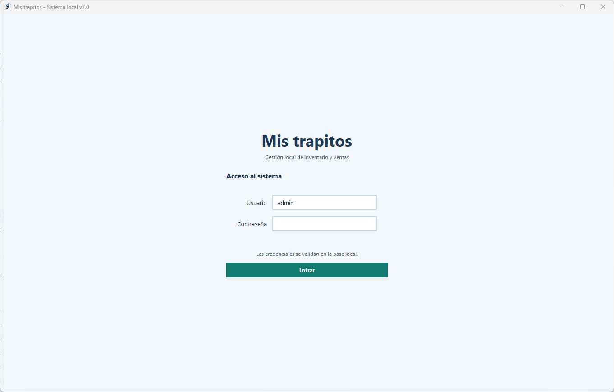
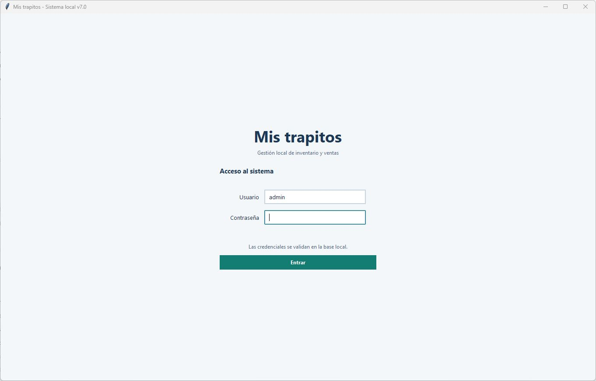

# Carlos Fonseca — ATS_INS_01

**Resultado: aprobado.**

| Dato | Registro |
| --- | --- |
| Fecha de ejecución | 29 de octubre de 2026 |
| Participante | Carlos Fonseca |
| Rol | Cliente principal, con conocimiento previo de los requisitos |
| Facilitadora y responsable de validación de instalación | Elizabeth Barajas |
| Participación | Ejecución manual con participante |
| Equipo | LAPTOP-PRUEBA-01: laptop de pruebas limpia, sin base de datos previa |
| Versión del código | b93812dc4002aad9b35122d93d9cef462c244327 (rama test/75-aceptacion-manual, PR #80) |
| Paquete instalado | codigo.zip, SHA-256 3f6ffbdb62ed190611d15eda9821b1ff579c93db6abef5d80c34686226c62546; dependencias desde wheelhouse local |
| Conectividad | Sin acceso a internet durante la instalación y las comprobaciones: Wi-Fi desactivado y cable de red desconectado |
| Horario de la sesión | 20:30–20:40 |
| Duración de la sesión completa | 10 minutos |
| Tiempo de registro y venta | 1 minuto |
| Referencia horaria | Registro manual de la sesión |
| Asistencia | Explicación breve inicial de las funcionalidades añadidas, el estado del proyecto, la tarea a realizar, en qué consistía la prueba y los criterios de medición. No se explicó el funcionamiento de la aplicación ni se indicaron pantallas, menús o botones antes de la prueba; registro y venta sin ayuda |
| Incidencias | Ninguna |

## Procedimiento y resultados

| Comprobación | Resultado observado |
| --- | --- |
| Preparación | PC limpio, sin base de datos previa. |
| Instalación sin internet | Instalación completada correctamente, manteniendo la desconexión. |
| Primer arranque | Inicio de sesión correcto y apertura de Productos operativa. |
| Cierre y segundo arranque | Aplicación cerrada y abierta nuevamente sin restablecer internet. |
| Comprobación tras la reapertura | Inicio de sesión y apertura de Productos correctos. |
| Validación manual | Realizada por Elizabeth Barajas; resultado satisfactorio. |

[Registro manual](registro_manual.json).

## Evidencias gráficas

