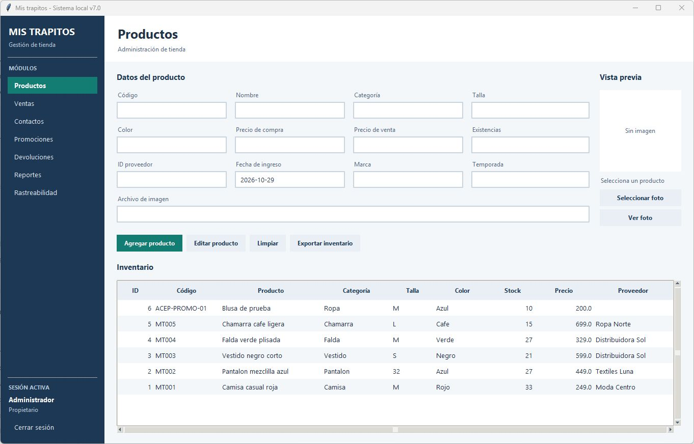
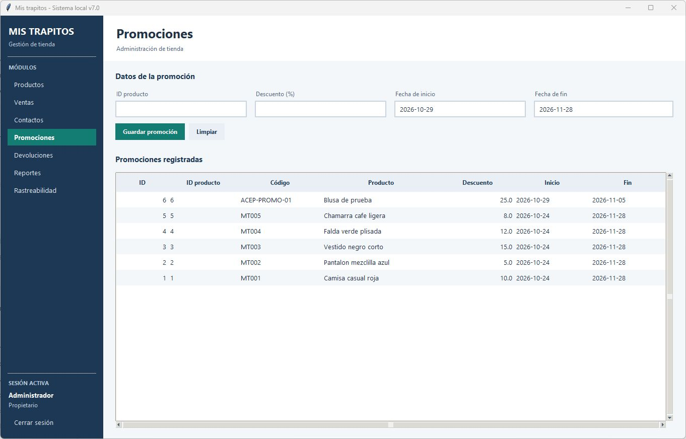
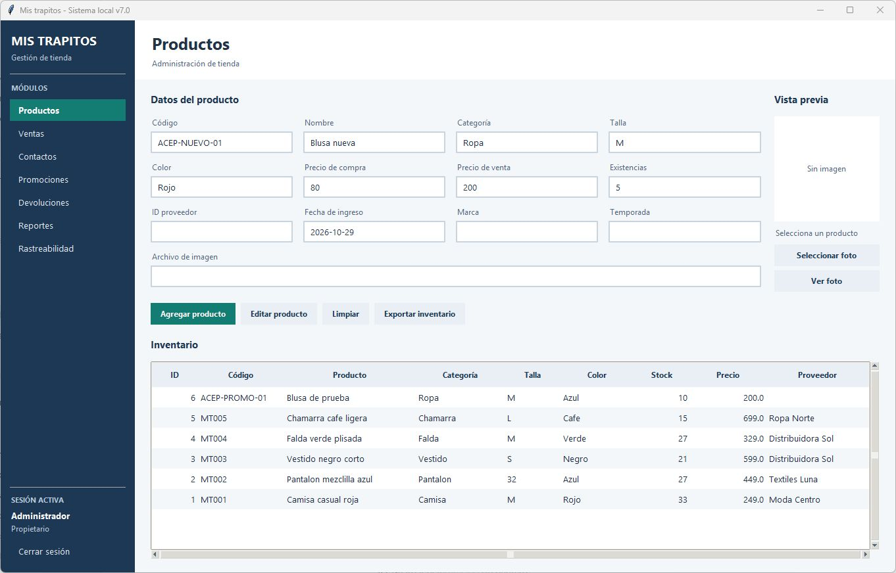
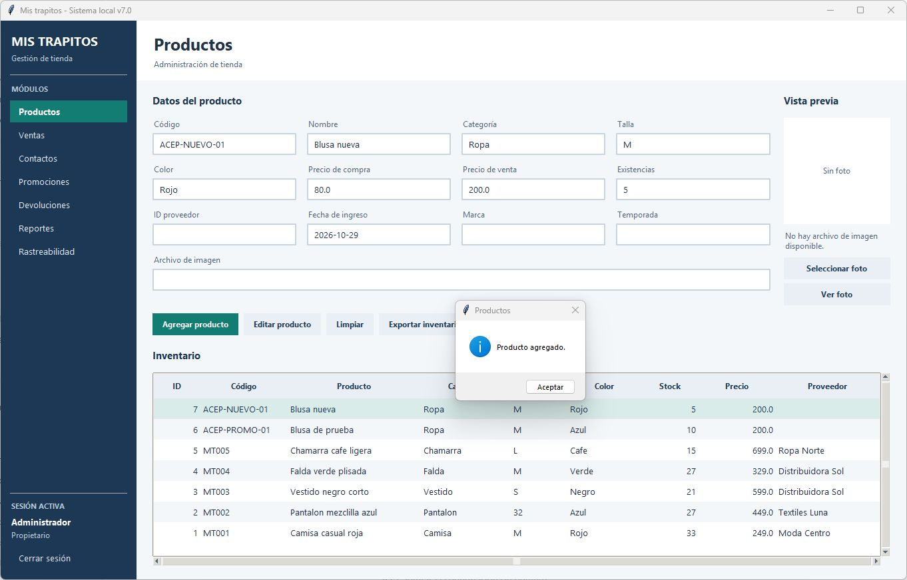
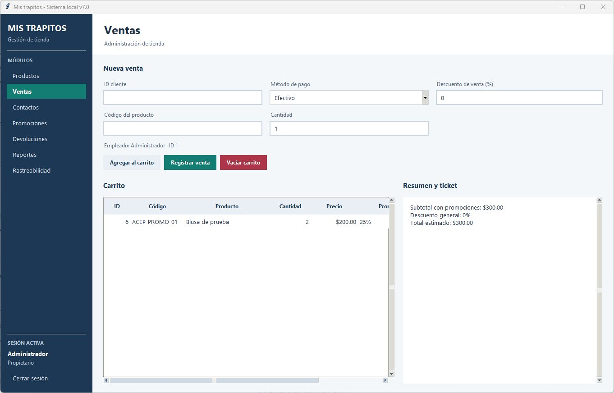
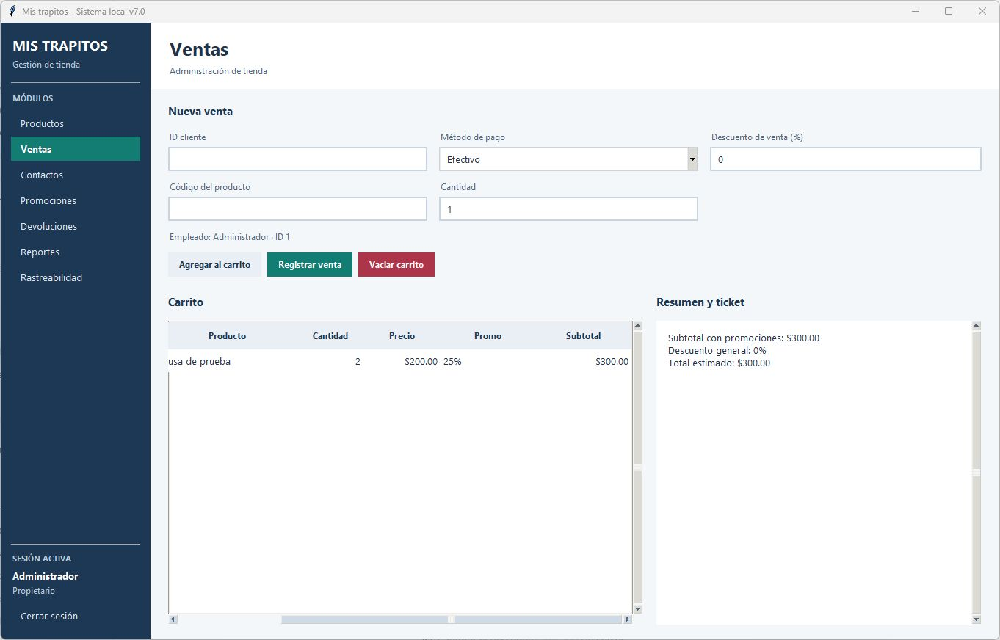
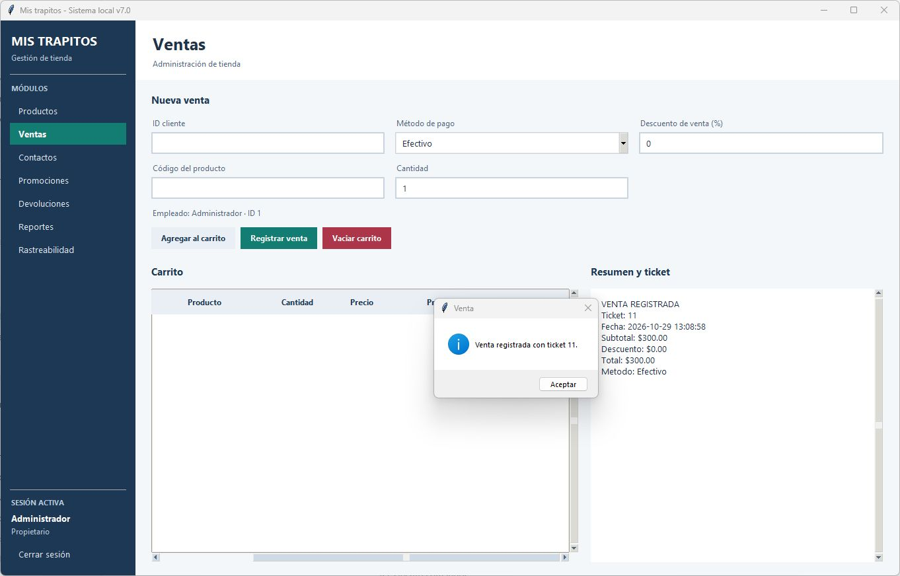
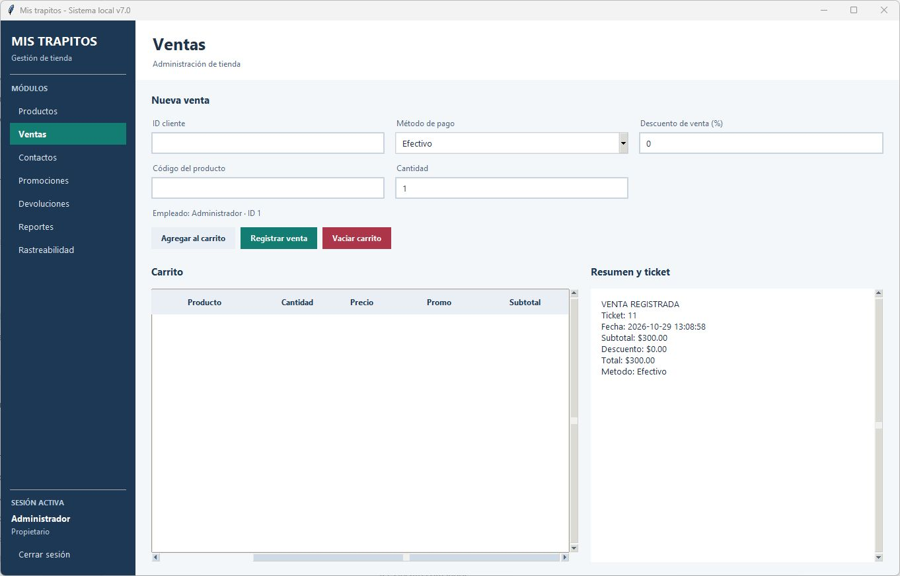
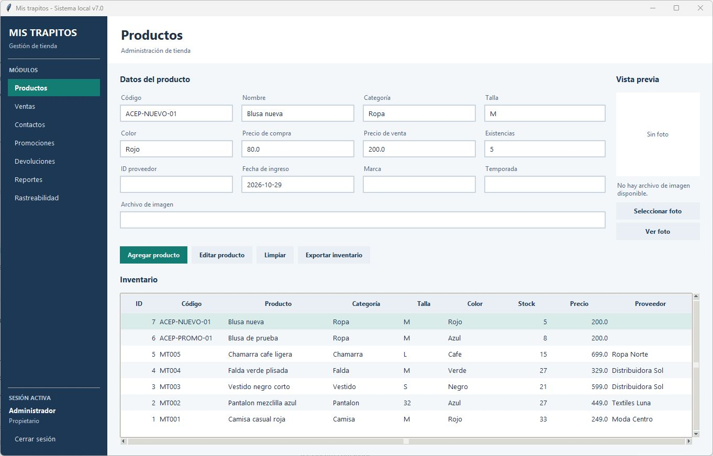

# Carlos Fonseca — ATS_UX_01

**Resultado: aprobado.**

| Dato | Registro |
| --- | --- |
| Fecha de ejecución | 29 de octubre de 2026 |
| Participante | Carlos Fonseca |
| Rol | Cliente principal, con conocimiento previo de los requisitos |
| Facilitadora y responsable de validación de instalación | Elizabeth Barajas |
| Participación | Ejecución manual con participante |
| Equipo | LAPTOP-PRUEBA-01: laptop de pruebas limpia, sin base de datos previa |
| Versión del código | b93812dc4002aad9b35122d93d9cef462c244327 (rama test/75-aceptacion-manual, PR #80) |
| Paquete instalado | codigo.zip, SHA-256 3f6ffbdb62ed190611d15eda9821b1ff579c93db6abef5d80c34686226c62546; dependencias desde wheelhouse local |
| Conectividad | Sin acceso a internet durante la instalación y las comprobaciones: Wi-Fi desactivado y cable de red desconectado |
| Horario de la sesión | 20:30–20:40 |
| Duración de la sesión completa | 10 minutos |
| Tiempo de registro y venta | 1 minuto |
| Referencia horaria | Registro manual de la sesión |
| Asistencia | Explicación breve inicial de las funcionalidades añadidas, el estado del proyecto, la tarea a realizar, en qué consistía la prueba y los criterios de medición. No se explicó el funcionamiento de la aplicación ni se indicaron pantallas, menús o botones antes de la prueba; registro y venta sin ayuda |
| Incidencias | Ninguna |

## Ejecución manual

| Criterio | Resultado |
| --- | --- |
| Registro del producto y venta | Completados correctamente. |
| Duración del recorrido | 1 minuto |
| Criterio temporal | Cumple: recorrido inferior a 300 segundos. |
| Asistencia inicial | Explicación breve inicial de las funcionalidades añadidas, el estado del proyecto, la tarea a realizar, en qué consistía la prueba y los criterios de medición. No se explicó el funcionamiento de la aplicación ni se indicaron pantallas, menús o botones antes de la prueba. |
| Autonomía durante el recorrido | Evaluada; operaciones completadas sin asistencia posterior. |
| Funcionamiento sin internet | Satisfactorio. |
| Dudas e incidencias | Sin consultas posteriores ni incidencias durante el recorrido. |

## Resultados funcionales del material gráfico

| Comprobación | Resultado |
| --- | --- |
| Producto nuevo | ACEP-NUEVO-01, Blusa nueva, existencias finales: 5. |
| Venta | Dos unidades de ACEP-PROMO-01; precio unitario: $200.00. |
| Promoción | 25 %; descuento general de venta: 0 %. |
| Ticket | Número 11; pago en efectivo; total: $300.00. |
| Inventario del producto vendido | Existencias iniciales: 10; finales: 8. |

[Registro manual](registro_manual.json) · [Datos funcionales](datos_funcionales.json).

## Evidencias gráficas

